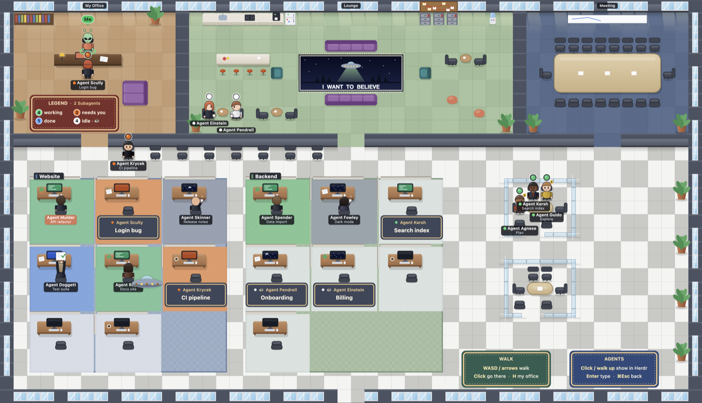

# The Bureau

A walkable 2D office for macOS where every AI coding agent running in [Herdr](https://herdr.dev) –
Claude Code or any other agent Herdr detects – is a character at a desk. Herdr itself runs on the
left, a shell top right, the office bottom right.



- **Teams:** each Herdr space is a team area; every agent has a cubicle with its name and tab.
- **Status at a glance:** the cubicle floor is green while the agent works, grey when it is idle,
  blue when it is done and orange when it needs you.
- **Needs you:** the agent walks into your office, the others wait on the chairs outside. Agents
  also say "… is done" or "… needs you" out loud.
- **Nothing to do:** idle agents drink coffee, read the paper or stretch at their desk, or take a
  break in the lounge.
- **Subagents:** a UFO beams them into a meeting pod next to their agent.
- **You** are the alien: while nobody waits, you walk to whichever agent's tab Herdr shows. Click an
  agent or its desk to jump to its tab.
- **Shortcuts:** on the rugs by the entrance and in the Help menu (⌘/).

## Requirements

- macOS on Apple Silicon (speech, fonts and the packaged app are Mac-only; Intel is untested)
- Node.js 24 with npm
- [Herdr](https://herdr.dev) with one or more coding agents running in it
- Python 3, only for the Claude Code subagent hooks

## Install and start

In Terminal, download the project into a folder of your choice and build the app there:

```bash
git clone https://github.com/mlorenz42/the-bureau.git
cd the-bureau
npm install
npm run install-app   # builds the app and copies it to /Applications/The Bureau.app
```

Then start *The Bureau* like any other app. For development, `npm start` in the same folder runs it
from the source.

## Voices

Without extra voices every agent speaks with the macOS default voice. For distinct voices, search for
*Voice* in System Settings, click the ⓘ next to it and download a few English or German voices marked
*Premium* or *Enhanced*, then restart the app. German voices announce in German.

## Names

Agent Mulder and Agent Scully are always on the team. Replace the other names in
`~/Library/Application Support/the-bureau/settings.json` and restart the app:

```json
{ "names": ["Ada", "Linus", "Grace"] }
```

## Subagents (optional)

When a Claude Code agent starts subagents, they can show up in the office too. Herdr does not know
about subagents, so Claude Code has to tell the app itself, through *hooks*: small commands Claude
Code runs whenever a subagent starts or stops. Other agents simply appear without their subagents.

Set the hooks up once, in the `the-bureau` folder:

```bash
npm run hooks:install
```

- They go into `~/.claude/settings.local.json`, which applies to Claude Code sessions started in your
  home folder. For sessions started in a project folder, add them to that project's settings:
  `python3 -I scripts/hooks.py install <project>/.claude/settings.local.json`.
- New sessions pick them up; running sessions after a restart.
- While The Bureau is not running, the hooks do nothing and do not slow Claude Code down.
- If you stop using the app, remove them again with `npm run hooks:uninstall`.

## License

MIT. Unofficial hobby project, not affiliated with or endorsed by Anthropic or Herdr. The agent
names and the UFO decor are a fan nod to a 90s TV series; there is no connection to its makers or
rights holders.
